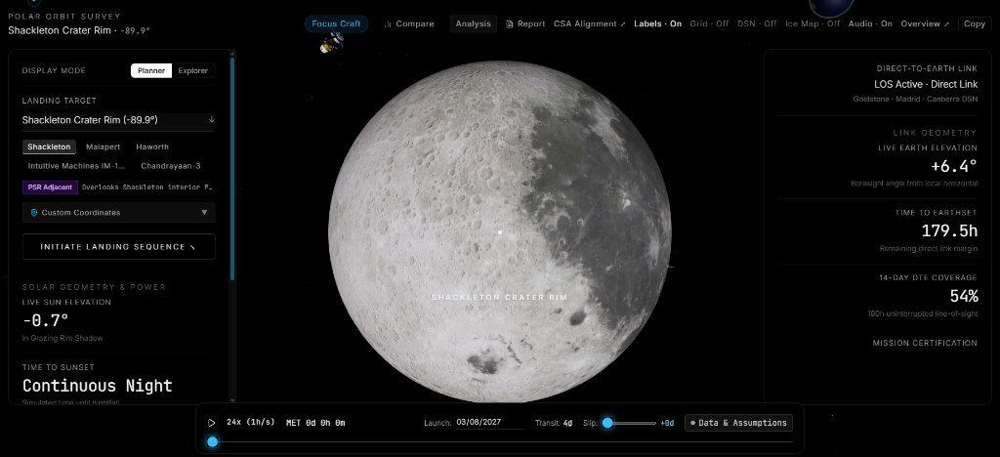
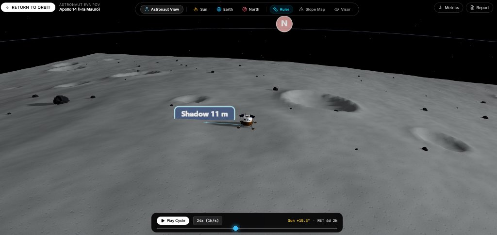
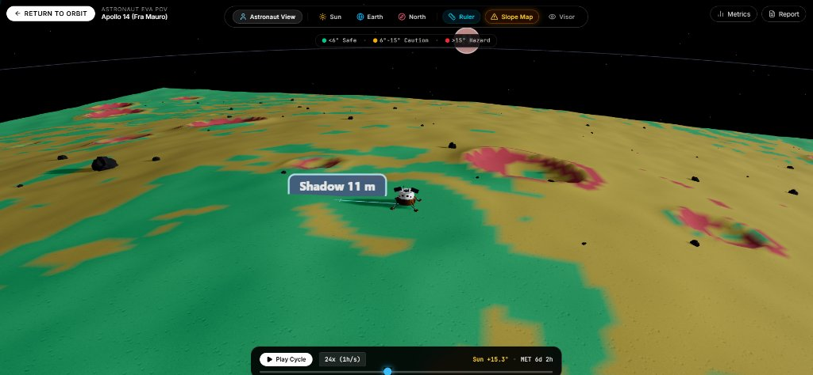
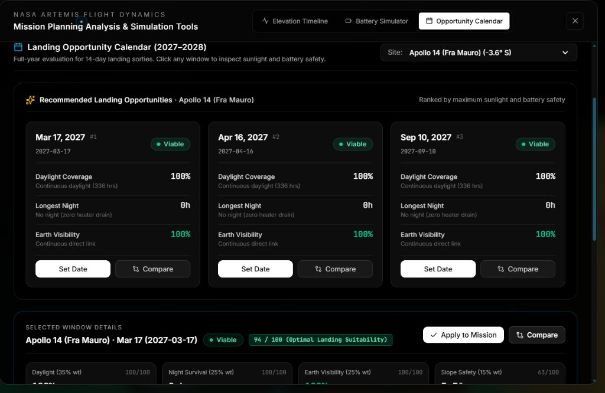
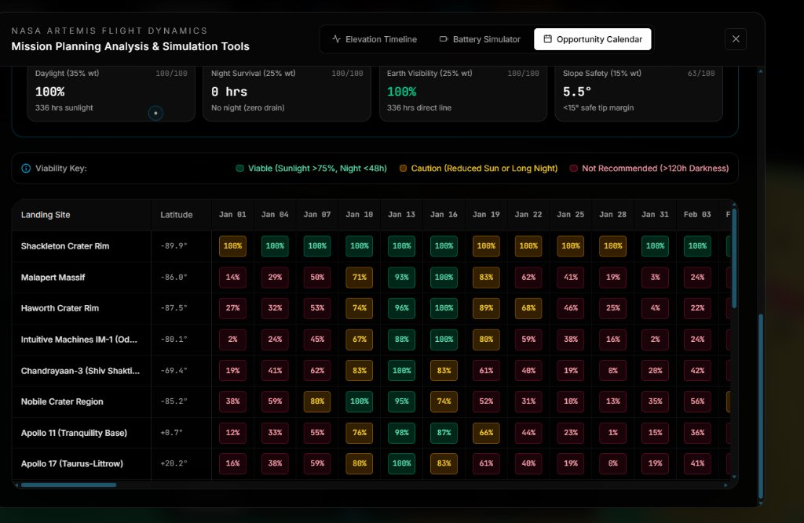
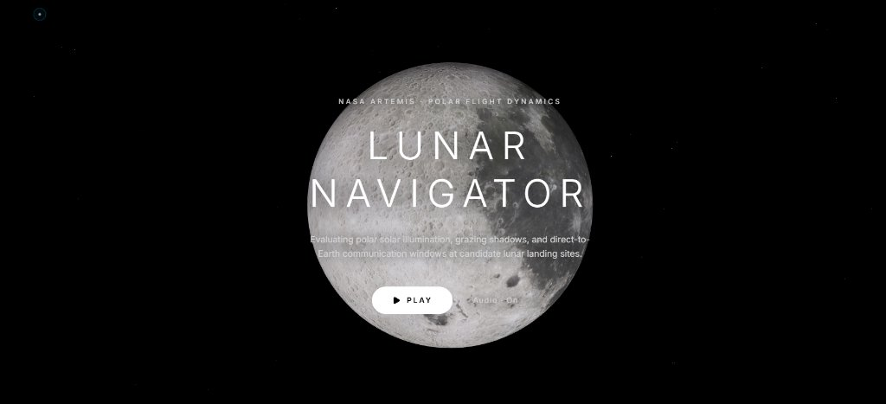

# Lunar Landing Site Navigator

> **NASA Space Apps Challenge 2026** — *Lunar Landing Site Navigator Challenge Entry*  
> An analytical flight-dynamics and mission-planning workstation for evaluating lunar south-pole landing sites, illumination windows, Direct-to-Earth communication links, battery endurance, and touchdown terrain safety across the 2027–2028 mission epochs.

---

## Visual Showcase

| 1. Polar Orbit Mission Planner & Telemetry HUD | 2. Ground-Level Astronaut EVA Simulation |
| :---: | :---: |
| <br><sub>**Orbital Mission Planner**<br>Interactive 3D Moon globe, targeting reticle, real-time Sun/Earth elevation, DTE link geometry, and PSR status</sub> | <br><sub>**Ground-Level Astronaut EVA Simulation**<br>400m tactical regolith patch, grounded Artemis lander, live Sun/Earth orientation, and metric shadow ruler</sub> |

| 3. Artemis Touchdown Slope Hazard Colormap | 4. 4-Factor Weighted Suitability Index |
| :---: | :---: |
| <br><sub>**Touchdown Safety & Slope Analysis**<br>Dynamic terrain hazard colormap: &lt;6° Safe (green), 6°–15° Caution (amber), &gt;15° Hazard (red)</sub> | <br><sub>**Multi-Disciplinary Suitability Index**<br>Live inspection with weighted score (Solar 35%, Night 25%, Comms 25%, Slope 15%) and letter grades</sub> |

| 5. Full-Year Mission Window Matrix (2027–2028) | 6. Aerospace Workstation Entry |
| :---: | :---: |
| <br><sub>**2027–2028 Mission Opportunity Matrix**<br>Full-year sortie viability heatmap with percentage coverage pills across all candidate sites</sub> | <br><sub>**Aerospace Workstation Entry**<br>High-contrast landing interface with spatial telemetry audio and flight dynamics orientation</sub> |

---

## Table of Contents
1. [Overview & Objective](#1-overview--objective)
2. [Step-by-Step Installation & Local Setup](#2-step-by-step-installation--local-setup)
3. [How to Use the Application (Step-by-Step Guide)](#3-how-to-use-the-application-step-by-step-guide)
4. [Core Features & Engineering Architecture](#4-core-features--engineering-architecture)
5. [Scientific Calculation Rules & Ephemeris](#5-scientific-calculation-rules--ephemeris)
6. [Scientific Limitations & Modeling Disclosures](#6-scientific-limitations--modeling-disclosures)
7. [Tech Stack & Automated Test Suite](#7-tech-stack--automated-test-suite)
8. [Data Provenance & Credits](#8-data-provenance--credits)

---

## 1. Overview & Objective

Operating near the lunar south pole presents extreme physical constraints:
- **Grazing Solar Angles:** The Sun hovers only $1.5^\circ$ to $3.0^\circ$ above the local horizon, casting massive horizontal shadows across craters.
- **Permanently Shadowed Regions (PSRs):** Deep crater floors never receive sunlight, maintaining cryogenic temperatures below $40\text{ K}$ ($-233^\circ\text{C}$) that can trap water ice but freeze lander avionics.
- **Intermittent Earth Line-of-Sight:** Due to the Moon’s $27.2\text{-day}$ optical and physical libration cycle, Earth dips below local crater ridges, cutting off Direct-to-Earth (DTE) communication.
- **Strict Battery Limits:** Extended nocturnal blackouts require significant battery capacity to power electric survival heaters ($20\text{ W}$).

**Lunar Landing Site Navigator** provides mission planners with quantitative, verified flight-dynamics analysis to determine when and where a lunar lander can safely touch down and survive.

---

## 2. Step-by-Step Installation & Local Setup

### Prerequisites
- **Node.js:** v18.0.0 or later (tested on Node.js 20 and 22 LTS).
- **npm:** v9.0.0 or later (bundled with Node.js).
- **Modern Web Browser:** Chrome 115+, Firefox 118+, Edge 115+, or Safari 17+ with WebGL 2.0 acceleration enabled.

### 1. Clone the Repository
```bash
git clone https://github.com/pavan-pks/lunar-navigator.git
cd lunar-navigator
```

### 2. Install Project Dependencies
```bash
npm install
```

### 3. Start the Local Development Server
```bash
npm run dev
```
Open your browser and navigate to the local server URL (typically `http://localhost:5173`).

### 4. Run the Automated Unit Test Suite
The project includes 39 unit tests validating geometry, ephemeris interpolation, battery models, scoring, and URL state:
```bash
npm run test
```

### 5. Build for Production
To generate an optimized, minified production build in `/dist`:
```bash
npm run build
npm run preview    # Previews the production build locally
```

---

## 3. How to Use the Application (Step-by-Step Guide)

```
+---------------------------------------------------------------------------------------------------+
| TOP BAR: Target Site | Date Selector | Launch Slip | Audio | Compare | Analysis | Report | Share  |
+---------------------------------------------------------------------------------------------------+
| LEFT HUD SIDEBAR:                | 3D INTERACTIVE VIEWPORT:                 | RIGHT HUD SIDEBAR:  |
| - Target Coordinates & Lat/Lon   | - Three.js Orbital Moon or Surface View  | - Earth DTE Status  |
| - PSR Proximity Tag              | - Spacecraft Orbit Mast Trajectory       | - Earth Elevation   |
| - Live Sun Elevation & Azimuth   | - Dynamic Shadow Physics                 | - 14-Day LOS %      |
| - Time to Sunset / Sunrise       | - Metric Shadow Ruler & Slope Map        | - Mission Verdict   |
+---------------------------------------------------------------------------------------------------+
| BOTTOM BAR: Play / Pause | Playback Speed (1x-240x) | MET Clock | Transit Days | Scrubber Timeline|
+---------------------------------------------------------------------------------------------------+
```

### Workflow 1: Site Selection & Target Lock


1. In the **Left HUD Sidebar**, click the **Landing Target** dropdown or select one of the candidate quick-pills (`Shackleton`, `Malapert`, `Haworth`, `Connecting Ridge`, `Nobile`).
2. The 3D camera will smoothly pivot and lock onto the selected site with a targeting reticle.
3. Review the site's **PSR Proximity Badge** (e.g., `PSR Adjacent: Volatile Cold Trap`) and nominal terrain slope margin ($<15^\circ$ tip-over threshold).
4. Alternatively, expand **Custom Coordinates** to input any precise lunar latitude ($-90^\circ$ to $+90^\circ$) and longitude ($-180^\circ$ to $+180^\circ$) on the Moon.

### Workflow 2: Launch Window Selection & Transit Slip
1. In the bottom control strip, set your planned **Launch Date** using the date picker.
2. Adjust the **Slip Slider** ($0\text{--}30\text{ days}$) to simulate programmatic or weather launch delays.
3. The application will instantly recompute the landing epoch ($\text{Landing Date} = \text{Launch} + \text{Transit} + \text{Slip}$) and recalculate all ephemeris vectors, solar lighting, and Earth visibility.

### Workflow 3: Trajectory Flight Budget & Delta-V Planning
1. In the bottom controls, click or hover over the **Transit: 4d** label.
2. The **Trajectory Flight Budget Tooltip** opens, detailing flight mechanics:
   - **Apollo / Artemis Direct Transfer:** $3\text{--}5\text{ days}$ transit, $\text{TLI } \Delta v \approx 3,150\text{ m/s}$, $\text{LOI } \Delta v \approx 850\text{ m/s}$, $\text{Total } \Delta v \approx 4,000\text{ m/s}$.
   - **Low-Energy Transfer (WSB / BLT):** $90\text{--}120\text{ days}$ via Sun-Earth L1/L2, saving $\sim 18\%$ $\Delta v$ ($\sim 750\text{ m/s}$, $\text{Total } \Delta v \approx 3,250\text{ m/s}$).
3. Adjust the slider ($3\text{--}14\text{ days}$) or click a preset to stage your transit timeline into the mission plan.

### Workflow 4: 4-Factor Suitability Scoring & Opportunity Calendar


1. Click the **Analysis** button in the top navigation bar.
2. Select the **Opportunity Calendar** tab to view the full-year ($2027\text{--}2028$) matrix across candidate sites.
3. Review the **4-Factor Suitability Score** ($0\text{--}100$) combining Solar (35%), Night Survival (25%), Earth Comms (25%), and Slope Safety (15%).
4. Click any cell in the heatmap matrix:
   - The **Selected Window Details** card immediately updates with daylight coverage %, continuous darkness hours, and Earth visibility.
   - Click **Apply to Mission** to automatically load that site and launch date directly into the main 3D simulation.

### Workflow 5: Battery Survival Simulator ("Will It Survive The Night?")
1. In the **Analysis** modal, open the **Battery Simulator** tab.
2. Configure your lander’s power subsystem:
   - **Solar Array:** Horizontal deck panel vs. Vertical sun-tracking mast ($>28\times$ higher power capture at grazing polar angles).
   - **Capacities & Loads:** Adjust battery capacity (Wh), solar array peak (W), avionics base load (W), and electric night heating (W).
3. Inspect the state-of-charge (SoC Wh) curve across the 14-day mission to check if reserves remain above freezing during darkness.

### Workflow 6: Ground-Level Astronaut EVA Simulation & Shadow Ruler


1. In the Left HUD Sidebar, click **Enter Surface Simulation**.
2. The camera smoothly descends to human eye level ($1.7\text{m}$) standing on a local $400\text{m} \times 400\text{m}$ tactical patch beside the grounded Artemis lander.
3. Click **Sun**, **Earth**, or **North** on the top action bar to orient your visor.
4. Toggle the **Metric Shadow Ruler** to measure real-time shadow lengths cast by the lander.
5. Toggle the **Slope Map** to view the real-time Artemis landing slope safety colormap ($<6^\circ$ Safe, $6^\circ\text{--}15^\circ$ Caution, $>15^\circ$ Tip-Over Hazard).

### Workflow 7: Side-by-Side Comparison & Formal Report Export
1. Click **Compare** in the top bar to open split-screen mode: compare two distinct sites, or one site on two different dates, driven by a shared time scrubber.
2. Click **Report** to generate a print-ready formal mission certification summary.
3. Click **Print / Export PDF** (`Ctrl+P` / `Cmd+P`) for formal documentation.

---

## 4. Core Features & Engineering Architecture

| Feature | Engineering Implementation | Primary Benefits |
| :--- | :--- | :--- |
| **4-Factor Suitability Index** | Multi-disciplinary scoring engine (`src/lib/metrics.js`) weighting Solar (35%), Night (25%), Comms (25%), and Slope (15%). | Replaces subjective opinions with a rigorous, objective composite score ($0\text{--}100$). |
| **PSR Identification** | Embedded metadata taxonomy classifying crater rim cold traps ($<40\text{ K}$) vs. non-PSR highlands. | Identifies prime water-ice exploration targets while warning of cryogenic thermal hazards. |
| **Electrochemical Battery Model** | Discrete time-step numerical integration (`src/lib/energy.js`) modeling array angle, irradiance, and thermal heater drain. | Answers the critical mission question: *"Will the lander survive the continuous polar night?"* |
| **Trajectory Flight Budget** | Analytical Keplerian two-body and Weak Stability Boundary delta-v approximations. | Enables rapid evaluation of crewed direct insertions vs. low-energy uncrewed cargo transits. |
| **Astronaut EVA View** | Grounded $400\text{m} \times 400\text{m}$ procedural regolith patch with authentic albedos, rock displacement, and ACES Filmic lighting. | Provides tactical situational awareness for astronaut walking operations and surface experiments. |
| **Opportunity Calendar** | Memoized full-year heatmap ($2027\text{--}2028$) evaluating 23 landing sites in 3-day steps. | Highlights optimal multi-day landing windows at a single glance. |
| **Zero Emoji Interface** | Restrained aerospace instrument styling utilizing Lucide vector icons and clean typography. | Delivers a credible, professional engineering aesthetic suitable for formal presentations. |

---

## 5. Scientific Calculation Rules & Ephemeris

All astronomical angles and calculations adhere strictly to NASA mission standards:

1. **Solar Illumination Threshold ($h > -0.27^\circ$):**  
   The Sun is considered above the horizon when its center elevation $h$ exceeds $-0.27^\circ$, accounting for the apparent solar angular semi-diameter ($16\text{ arcmin}$) at $1\text{ AU}$.
2. **Earth Line-of-Sight Threshold ($h > 0.0^\circ$):**  
   Direct-to-Earth communication is available whenever Earth center elevation exceeds the local horizontal datum ($0.0^\circ$).
3. **Geometric Shadow Calculation:**  
   The shadow length $L$ cast by an upright mast of height $H$ on local flat ground is computed as:
   $$L = \frac{H}{\tan(h)} \quad (h > 0^\circ)$$
   If $h \le 0^\circ$, the shadow length evaluates to $\infty$ (sub-horizon nocturnal darkness).
4. **Ephemeris Dataset:**  
   Sub-solar and sub-Earth selenographic coordinates are precomputed from the NASA JPL Horizons On-Line Ephemeris System (DE440 ephemeris, observer center `500@301`) over the 2027–2028 lunar exploration epoch.

---

## 6. Scientific Limitations & Modeling Disclosures

In compliance with NASA Space Apps scientific integrity standards, the following modeling assumptions and limits are explicitly disclosed:

- **Smooth-Sphere Datum ($R = 1,737.4\text{ km}$):**  
  Astronomical elevation and azimuth angles are computed relative to the mean spherical Moon. The ephemeris model does not ray-march distant crater rims ($>20\text{ km}$ away) that may occasionally block a grazing sun beam.
- **Local 400m Tactical Patch vs. Orbital Satellite DEMs:**  
  Our ground-level surface simulation models the immediate $400\text{m} \times 400\text{m}$ landing zone at human scale ($1.7\text{m}$ eye level). Because global satellite DEMs (such as LOLA 400m/pixel) represent this entire patch as a single pixel, our 3D terrain utilizes deterministic, seeded procedural morphology matching published site archetypes (e.g. knife-edge ridge at Shackleton, highland massif at Malapert, flat basalt mare at Apollo 11).
- **Ephemeris Coverage Range:**  
  Ephemeris vectors are valid for epochs within the 2027–2028 dataset. The application automatically detects and warns if a date falls outside this coverage range.
- **Geocenter Line-of-Sight:**  
  Earth visibility is referenced to the Earth center-of-mass (geocenter). Topocentric parallax to specific Deep Space Network dishes (Goldstone, Madrid, Canberra) introduces up to $\sim 0.26^\circ$ angular deviation at the lunar limb.
- **Light-Travel Time Delay:**  
  Calculations are evaluated instantaneously in Barycentric Dynamical Time (TDB/UTC); the $\sim 1.28\text{ s}$ one-way Earth-Moon radio propagation delay is neglected.

---

## 7. Tech Stack & Automated Test Suite

### Core Technologies
- **Application Framework:** React 19, Vite 6
- **3D Graphics & Shading:** Three.js, React Three Fiber (`@react-three/fiber`), Drei (`@react-three/drei`)
- **Styling & Motion:** Tailwind CSS 4, Framer Motion
- **Quantitative Charting:** Recharts (Elevation timelines, battery state-of-charge curves)
- **Vector Icons:** Lucide React
- **Unit Testing:** Vitest

### Automated Unit Test Suite
The repository includes comprehensive automated test coverage across all mathematical and flight-dynamics modules:
```bash
npm run test
```
- `src/lib/geometry.test.js`: Validates sub-solar/sub-Earth coordinate transformations and horizon angle calculations.
- `src/lib/metrics.test.js`: Validates shadow lengths, window statistics, verdict thresholds, and 4-factor suitability scoring.
- `src/lib/energy.test.js`: Validates diurnal harvesting, battery state-of-charge curves, and survival heater electrical draws.
- `src/lib/calendarData.test.js`: Validates full-year opportunity matrix memoization and window ranking algorithms.
- `src/lib/validation.test.js`: Validates ephemeris range boundary clamping and input validation.
- `src/lib/urlState.test.js`: Validates shareable URL hash encoding and state restoration.
- `src/lib/captions.test.js`: Validates educational explorer caption generation.
- `src/lib/dataLoader.test.js`: Validates JSON schema integrity and dataset caching.

---

## 8. Data Provenance & Credits

- **Ephemeris Vectors:** NASA Jet Propulsion Laboratory (JPL) Horizons On-Line Ephemeris System.
- **Topographic Context:** NASA Lunar Reconnaissance Orbiter (LRO) Lunar Orbiter Laser Altimeter (LOLA) and LROC QuickMap.
- **Thermal Baselines:** NASA LRO Diviner Lunar Radiometer Experiment.
- **Landing Site Coordinates:** NASA Artemis Candidate Landing Regions, NASA Commercial Lunar Payload Services (CLPS) Initiative, and ISRO Chandrayaan-3.

*Disclaimer: This project was developed as an educational and analytical mission-planning workstation for the NASA Space Apps Challenge 2026. It is not an official NASA mission operation tool and is not endorsed by NASA.*

---

## 9. License

This project is open-source under the [MIT License](LICENSE).
